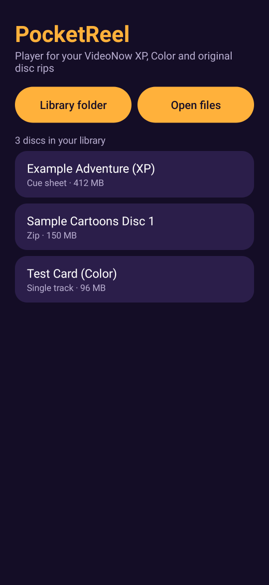
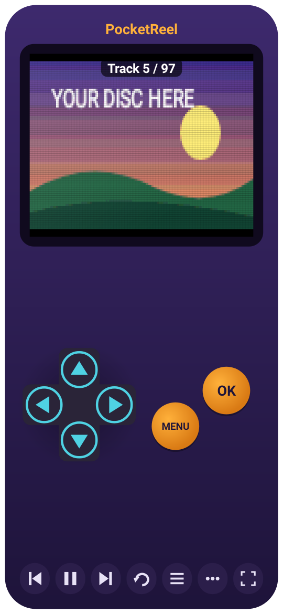
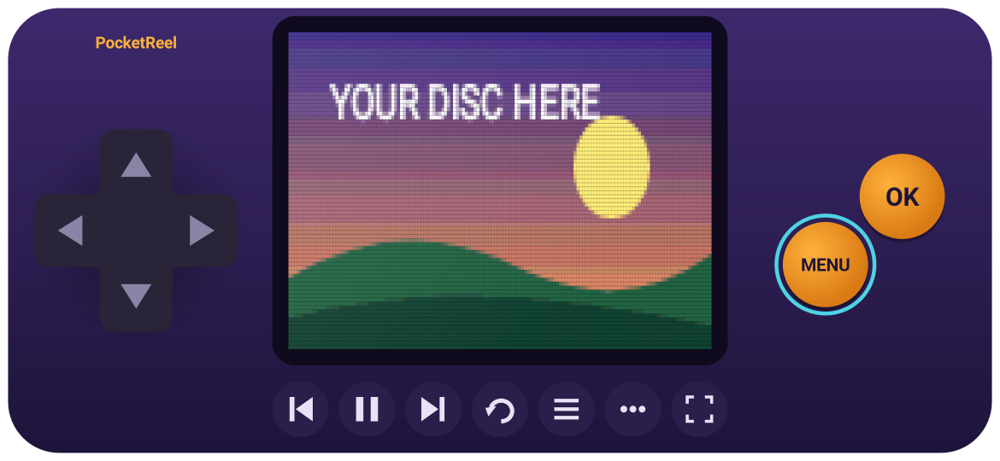

# PocketReel

An Android player for VideoNow personal video discs: **VideoNow XP** (including the interactive
adventures and quiz discs), **VideoNow Color / Jr / Color FX**, and the original **black and white**
discs. Bring your own rips.

PocketReel is an independent fan project. It is not affiliated with, endorsed by or connected to
Hasbro or Tiger Electronics. "VideoNow" is a trademark of its owner and is used here only to say which
discs the app can play. No disc content, logos or firmware are included.

## What it does

- Decodes the disc stream directly: 144 × 80 picture with 4-bit colour channels, 8-bit mono sound at
  35 280 Hz (XP/Color, read at twice CD speed), or 80 × 80 greys at 44 100 Hz for black and white.
- Plays interactive XP discs the way they were built: each segment's header carries its branch table,
  so choices, timed prompts, quiz scoring and score-based endings all come from the disc itself.
- Picture and sound stay in sync off the audio clock.
- An original handheld-style skin: D-pad and OK/MENU buttons for the disc's six choices, transport keys,
  track list, an optional LCD effect, 4:3 or stored-grid picture, and a full-screen mode.
- Optional highlighting of the buttons the current scene responds to.
- Game controllers and keyboards work (D-pad, A/X = OK, B/Y = MENU, Start = pause, L1/R1 = skip,
  L2 = go back a scene, Select = track list).

## Getting started

**1. Install.** Download the APK from the latest build (GitHub **Actions** → *Build* → artifact
`PocketReel-apk`) and open it on your phone. You may need to allow installs from your browser or
file manager.

**2. Add your discs.** Rip your discs on a PC with a CD drive (they are ordinary audio CDs to a
drive; any ripper that writes `.cue` + `.bin` works. Use a tray drive: the discs are smaller than a
normal CD and a slot-loading drive can't take them). Copy them to your phone, then tap
**Library folder** and choose the folder that holds them. PocketReel lists every disc it finds,
in sub-folders too, plus any `.zip` rips. To open just one disc, tap **Open files** and select
the `.cue` together with its `.bin` files (or a single `.zip`).



**3. Play.** Tap a disc. It starts on the disc's first scene. On interactive XP discs the buttons
the current scene responds to light up in blue: press one to choose. The track number shows
briefly whenever the disc moves to a new scene.



**4. The buttons along the bottom**, from left to right: previous track, play/pause, next track,
**back a scene** (undo a wrong choice), **track list**, **settings**, and **full screen** (tap the
picture to bring the controls back). Turn the phone sideways for the landscape layout.



**Settings** lets you switch off the button highlights or the LCD effect, show the stored pixel
grid instead of the true 4:3 shape, play every track in order (ignoring the disc's branching), or
loop the disc.

*The screenshots are rendered from the app's own code off-device; the picture on the screen is a
placeholder drawing, not a real disc.*

## Supported rips

- `.cue` + `.bin` (one file per track, or a single `.bin`)
- `.zip` of the above (Redump-style sets), unpacked to the app's cache when opened
- a single raw track (`.bin` / `.raw`) or a `.wav` rip of one track

Pick a **library folder** once and PocketReel lists every disc in it, or use **Open files** and select a
`.cue` together with its `.bin` files (or a `.zip`).

## Controls

| Disc button | Screen | Controller | Keyboard |
|---|---|---|---|
| 1 | D-pad up | D-pad up | 1 / W / ↑ |
| 2 | D-pad right | D-pad right | 2 / D / → |
| 3 | D-pad down | D-pad down | 3 / S / ↓ |
| 4 | D-pad left | D-pad left | 4 / A / ← |
| 5 | OK | A or X | 5 / Enter |
| 6 | MENU | B or Y | 6 / M |

The undo-arrow key steps back to the previous scene, which is handy after a wrong turn.

## Building

GitHub Actions builds a debug APK on every push (see the **Actions** tab, artifact `PocketReel-apk`).
Locally: `gradle :app:assembleDebug`. Screenshots: `gradle :app:testDebugUnitTest --tests '*Screenshots*'`. The `tools` module is a desktop test harness:

```
gradle :tools:installDist
tools/build/install/tools/bin/tools info  "Disc.cue"
tools/build/install/tools/bin/tools run   "Disc.cue" out/ 60 46:1   # play 60 s, press button 1 at 46 s
```

## Credits

- **[vxp](https://github.com/zdiemer/vxp)** by the VideoNow XP Emulator contributors (MIT): the disc
  format research, the picture decoder and the interactive player logic are ported from it. See
  `NOTICE` for its licence.
- **[PVDTools](https://github.com/saramibreak/PVDTools)** by saramibreak, and the VideoHelp forum
  community, for the original work on the VideoNow disc format that vxp builds on.
- **[Robolectric](https://robolectric.org)** (MIT) renders the tutorial screenshots in tests.

## AI use

PocketReel was built with heavy use of AI. Most of its code and documentation was written by
Anthropic's Claude, working from my direction, testing and review. It has been tested against real
disc rips, but it hasn't had the years of use that long-established software has, so please report
anything that doesn't work.

## Licence

MIT, see `LICENSE`. Copyright (c) 2026 PocketReel contributors.
